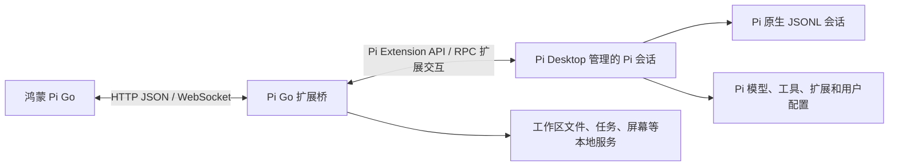

# Pi Go 鸿蒙客户端与 Pi Desktop 扩展实施计划

> 状态：已验证 Pi CLI RPC、鸿蒙 USB 真机聊天与停止、多标签切换、适配版 Desktop 的原生历史打开和新建、项目恢复及双端交互。阶段 1 已实现 HTTPS LAN 配对、撤销、UDP 发现及 HUKS 多电脑列表；阶段 2 已接入 broker /events SSE 流式透传与手机实时渲染（文本增量/思考/工具活动），发送后可实时看到 Agent 运作；附件能力已升级为多图（≤4）+ 任意文件（≤3，8MB）经 `POST /upload` 暂存后随 prompt 发送；反向已支持电脑→手机发送：任意工作区文件（≤64 MiB）经 `GET /files/download` 原样下发，工作区浏览、聊天路径卡片与工具活动条均可点击接收并用系统预览打开；手机侧边栏已支持长按空间弹出菜单远程关闭工作区（双端同步移除、不删文件、下次刷新不再显示，需重打包 Desktop 后生效）；聊天输入已支持 `/` 唤起命令面板并列出/调用当前会话的技能、提示词模板与扩展命令（`/skill:名字 参数`）。真机相机扫码配对全流程、流式与附件真机验收待完成。见 [阶段 0 验证记录](docs/phase-0.md)、[USB 真机联调](docs/usb.md) 与 [LAN 配对](docs/lan.md)。  
> 更新日期：2026-11-21  
> 项目目标：通过鸿蒙手机安全地连接 Pi Desktop，查看、恢复和控制电脑上的 Pi coding agent 会话。  
> 异地访问：已加入独立的 VPS 公网 IPv4 与 SSH 反向隧道入口，待实际 VPS 和鸿蒙蜂窝网络联调。见 [公网配对](docs/remote.md)。
>
> Pi CLI 宿主：macOS 可用 `daemon/` 托管 Pi RPC 会话和工作区，同时保留交互式 Pi CLI 会话共享。USB 桥和 daemon 支持通过 launchd 登录自启。安装与验收见 [daemon/README.md](daemon/README.md)。

## 1. 背景与目标

Pi Go 由两个交付物组成：

1. **鸿蒙客户端**：展示电脑、项目、Pi 会话和消息；发送操作并接收状态。
2. **Pi Desktop 扩展**：安装在 Pi Desktop 使用的 Pi 扩展环境中，向手机提供配对、会话目录、会话控制和实时事件桥接。

目标是让用户能在手机上看到电脑现有的 Pi 会话，打开历史会话、新建会话、恢复会话，并控制 Pi 持续完成工作。Pi Desktop 继续管理自己的会话运行时；Pi Go 不单独复制一套 Pi CLI 管理产品，也不另建聊天历史数据库。

能力范围以 DSH Go 当前已实现的 0.2.0 为对照，包括连接配对、会话和聊天、交互、扩展/包管理、任务、工作区、文件、桌面视图和屏幕监视。原版 DSH 中当前未接入的账号、会员、公网云服务、后台推送和系统卡片不属于本期持平范围。

## 2. 已确认的目标环境

本机安装的 Pi Desktop 应用标识为 `dev.pi.desktop-gui`，版本 `0.2.2-alpha`，对应 FaqFirebase 的 Pi Desktop 项目。该项目说明 Pi Desktop 通过 Pi RPC 管理 Pi 会话，并支持 Pi 扩展、包和扩展 UI 请求。当前 Pi CLI 为 1.4.0。

Pi Desktop 项目处于 alpha 阶段，接口、RPC 转发和会话行为可能变化。首期应锁定测试版本，并验证关键扩展行为；更新 Pi Desktop 或 Pi 版本时执行兼容性验收。

## 3. 推荐架构

Pi Go 扩展桥部署在电脑上，由 Pi Desktop 加载。它通过 Pi 的扩展接口操作当前运行时，并将手机协议封装在扩展桥的 HTTP/WS 服务中。手机不直接连接 Pi RPC 的标准输入/输出。

**重要实现边界：** FaqFirebase 版 Pi Desktop 提供 Pi 扩展能力；本方案不假设它提供可供第三方使用的桌面主进程插件 API。手机连接服务应由 Pi Go 扩展包负责。扩展如何在多会话时提供单一稳定入口、桌面没有活跃会话时是否仍能启动，须在阶段 0 验证。若扩展生命周期不足以承担常驻入口，可由扩展启动一个随 Pi Desktop 生命周期管理的本机 Bridge 子进程；该服务仍随扩展安装和管理，不另设第二套用户安装产品。

### 3.1 模块边界

**鸿蒙端**

- `ConnectionManager`：电脑列表、地址、发现、扫码/配对、断线恢复。
- `PiGoClient`：HTTP 请求、WebSocket 连接、请求编号和重试策略。
- `SessionStore`：项目和会话列表、分页、搜索、最近访问、置顶/归档元数据。
- `ChatState`：Pi 消息、工具事件、请求状态、未发送草稿、待处理交互。
- 页面：连接首页、项目/会话抽屉、聊天、工作区文件、扩展与任务、待处理面板、设置。

**Pi Desktop 扩展端**

- `PairingService`：短期配对码/票据、设备凭证、吊销。
- `BridgeServer`：鉴权 HTTP API、WebSocket、事件广播和大小限制。
- `SessionFacade`：读取会话目录、搜索、历史、创建、恢复、分叉、重命名、归档和所有权状态。
- `PiRuntimeAdapter`：对 Pi 扩展/RPC 接口做版本适配，规范化事件。
- `WorkspaceService`：已登记目录、文件预览与保存、路径范围限制。
- `ScheduleService`：Pi Desktop 没有对应的 DSH 自动任务接口时，由扩展端实现定时任务和记录。
- `ScreenService`：按需屏幕抓取；macOS 权限由系统授权。
- `DesktopView`：向手机提供电脑端 Pi 会话/终端视图所需的受保护代理能力。

协议对手机保持稳定；Pi 的扩展 API 和事件变化封装在 `PiRuntimeAdapter`，避免让 Harmony 页面直接依赖 Pi 内部类型。

## 4. DSH Console 能力对照

| 能力领域 | Pi Go 落地方式 | 主要边界/待验证点 |
|---|---|---|
| 连接、多电脑、扫码、六位码、UDP 发现 | 复用 DSH Go 的 Discovery、NodeStore、配对及设备撤销模型 | Pi Go Bridge 监听入口需明确端口、绑定地址和生命周期 |
| 凭证安全、自动重连 | 复用 HUKS AES-GCM 本地加密、设备凭证和重连状态机 | 不将配对票据、Cookie 或密钥写入日志 |
| Pi 会话浏览 | 扩展读取 Pi 原生会话目录，提供跨项目索引、搜索和分页 | 需验证会话索引与 Pi Desktop 当前会话的路径/名称一致 |
| 新建、恢复、历史、重命名、分叉、归档、置顶 | 优先走 Pi 官方扩展/RPC 会话操作；Pi 未提供的手机侧状态放 Bridge 元数据 | 恢复同一文件的并发写入必须有占用状态和控制权规则 |
| 聊天、模型选择、thinking level、停止和实时流 | Pi Extension API / RPC；WebSocket 转发文本、工具、运行、错误和结束事件；手机输入 `/` 唤起命令面板，经 `GET /commands` 列出当前会话可用命令（扩展命令、提示词模板与 `skill:` 技能），发送 `/skill:名字 参数` 等命令时由扩展开启输入展开（未知命令拒收、命令不允许附件） | Pi Desktop 版本变化要回归事件顺序和重复/丢失恢复 |
| 图片、附件、草稿、引用、Markdown | 图片（最多 4 张，单张 ≤512KB JPEG）经 `POST /upload` 暂存后随 prompt 以 token 引用，走 Pi 图像输入；普通文件（最多 3 个，单个 ≤8MB）同样暂存到会话工作区 `.pi-go/attachments/`，prompt 自动附上路径引用，交由 Pi 工作流读取 | 暂存内容寻址幂等，14 天自动清理；上传限流、内容类型检查（图片仍验证 JPEG 尺寸/大小）；文本上限 12000 字节 |
| 审批、选择题、自定义回答、多端竞争 | 扩展 UI 请求经 Bridge 转成手机卡片，再回传响应；必要时扩展拦截工具调用 | 普通 Pi 工具是否全部要求人工确认，不能从 DSH 行为推定，需分清交互问答与工具审批 |
| 插件管理 | 管理 Pi 扩展、包、技能、提示词和模型支持的资源 | 不等同于 DSH `pluginManager`；安装包来源、启停、重载和升级结果需适配 Pi 包机制 |
| 自动任务 | Bridge 提供定时器、任务 CRUD、执行记录及恢复 | 电脑休眠期间的错过任务策略、重启后的补执行规则需定义 |
| 工作区 | 目录登记、名称、创建、重命名、移除登记；保持 Pi 项目路径关联；手机侧边栏长按空间可关闭工作区（`POST /close-workspace`），电脑端同步从 Pi Desktop 移除登记，文件不删除 | “移除登记”/远程关闭均不删除目录；远程关闭仅限普通 folder 工作区（托管 worktree 需在电脑上操作）；项目批准/信任策略要显示给用户 |
| 文件操作 | 限定已登记工作区；浏览、预览、编辑、冲突检查；电脑→手机发送：任意工作区文件（≤64 MiB）经 `GET /files/download` 原样下发，工作区浏览/聊天路径卡片/工具活动条均可点击接收并用系统 PreviewKit 打开 | 符号链接逃逸、路径穿越、大小上限和原子写入；非预览类型仅提示已接收；真机点击打开待验收 |
| 桌面网页视图 | 提供 Pi 会话/终端的移动端网页或 WebSocket 视图 | Pi Desktop 没有可直接透传的 DSH 网页，需要单独实现终端/会话面板 |
| 屏幕监视 | 电脑端按需截图并在手机端刷新显示 | 首期沿用低帧率抓图；macOS 权限、停止和资源清理需验收 |

## 5. 手机与扩展协议草案

HTTP 适合请求/响应操作，WebSocket 适合持续事件。所有操作携带唯一 `requestId`；HTTP 状态码负责传输/鉴权错误，响应体单独表示 Pi 业务操作是否成功。

建议的首批路由：

| 路由 | 用途 |
|---|---|
| `GET /health` | Bridge 版本、Pi Desktop/Pi 版本、运行状态 |
| `GET /api/v1/projects` | 已发现/登记项目 |
| `GET /api/v1/sessions?projectId=&cursor=&query=` | 搜索和分页会话 |
| `POST /api/v1/sessions` | 在指定项目新建会话 |
| `POST /api/v1/sessions/:id/open` | 打开或恢复已有会话 |
| `GET /api/v1/sessions/:id/history` | 读取历史和分页游标 |
| `POST /api/v1/sessions/:id/prompt` | 文字/图片输入，明确队列行为；`/命令` 文本经白名单校验后展开（技能/模板/扩展命令） |
| `GET /api/v1/commands` | 当前会话可用的扩展命令、提示词模板与技能命令列表 |
| `POST /api/v1/sessions/:id/upload` | 手机附件原始字节上传，返回内容寻址 token |
| `POST /api/v1/sessions/:id/abort` | 中断运行 |
| `POST /api/v1/sessions/:id/model` | 选择模型及 thinking level |
| `GET /api/v1/pending` / `POST /api/v1/pending/:id/answer` | 待处理交互与应答 |
| `POST /api/v1/close-workspace` | 关闭指定工作区：电脑端移除登记、停掉其 Pi 进程，不删除文件；手机下次刷新不再显示 |
| `GET /api/v1/ws` | 实时事件复用通道 |

WebSocket 事件至少包括 `ready`、`session/status`、`message/delta`、`message/final`、`tool/start`、`tool/update`、`tool/end`、`interaction/requested`、`session/changed`、`error` 和带游标的 `snapshot`。重连后先取状态/历史基线，再处理新的增量；不要将实时流当作唯一历史来源。

Pi 在运行中时，手机在草稿为空时显示停止键，有文字或附件时显示发送键，发送默认使用 `steer`。`/events` 的 `session/status` 帧在运行开始就携带 `runId/queued`，排队成功后 `queue/status` 帧即时回传排队状态（旧版手机端忽略新帧），排队消耗与会话状态仍由 `/chat` 轮询兜底。发送超时会保留草稿，可通过请求编号核对桥接转发记录。

当前 USB/LAN 桥支持 `steer` 和 `followUp`，并提供运行时请求编号核对。回执确认桥接转发，模型处理进度由会话状态和事件提供。

手机已支持相册多选（最多 4 张）、拍照、缩放和发送多张 JPEG（草稿栏缩略图/文件芯片预览、可逐个移除），任意文件（最多 3 个，单个 8MB 内）经系统文件选择器发送；附件先上传到桥的 `POST /upload`（原始字节、内容寻址幂等、暂存在会话工作区 `.pi-go/attachments/`、14 天自动清理），再随 prompt 以 token 引用，文件路径自动附在消息里交给 Pi 读取；单张 JPEG 直发曾在真机验证，多图/文件已在离线 Pi RPC 集成测试中覆盖图片、文件、去重、越权名清洗、超限拒绝与错误分支，多图与文件真机验收待完成。发送框已按微信式交互加入「按住说话」：Core Speech Kit 离线中文语音转文字，松开即转文字发送、上滑取消、60 秒上限，忙时可转文字后选引导/补发。语音输入与拍照入口待真机验收。聊天中已显示附件数量，图片回看及导出仍待实现。

## 6. 分阶段实施计划

### 阶段 0：桌面扩展可行性验证

验证 FaqFirebase Pi Desktop `0.2.2-alpha` 与 Pi `1.4.0` 下：

- Pi 包安装后是否由 Pi Desktop 的每个 Agent/RPC 会话加载。
- 扩展能否获得稳定 session ID、工作目录、消息和运行事件。
- 扩展能否发送用户消息、停止或切换会话，并观察切换后的 Pi Desktop UI 状态。
- 扩展能否列出历史会话并打开指定会话。
- 多会话时是否有一个稳定的局域网监听器；最后一个会话关闭时服务如何处理。
- Extension UI 请求是否能由 Pi Desktop 展示并等待响应；手机答复后能否正确回到会话。
- Pi Desktop 退出/重启后，旧会话能否再次加载，扩展服务是否清理端口和锁。

**交付门槛：** 有一个可安装的最小 Pi 扩展，手机或本机脚本能完成配对、列会话、打开会话、发消息、收到增量并停止；记录扩展生命周期与多会话测试结果。此阶段决定使用会话内监听器还是扩展管理的本机 Bridge 子进程。

### 阶段 1：扩展桥与连接配对

- 建立包结构、Pi Desktop 安装说明、开发/卸载流程和版本标识。
- 实现 loopback/LAN 监听、UDP 发现、Host 来源检查、一次性配对码/票据和设备撤销。
- 将 DSH Go 的一次性配对凭证思路移入 Pi Go Extension；手机密钥仍用 HUKS 保存。
- 定义 HTTP/WS envelope、错误码、请求 ID、协议版本、body 大小和事件游标。
- 记录最少必要诊断信息，脱敏 URL 参数、Cookie、配对码、消息正文和附件。

**交付门槛：** 真机在同一 Wi-Fi 上可发现电脑、配对、重连、撤销设备；未配对请求和错误 Origin 被拒绝。

### 阶段 2：会话目录和聊天闭环

**当前进度（2026-11-20）：** 桥接端已实现跨共享项目目录、标题/项目/ID 搜索与分页，以及当前会话改名、模型/thinking level 切换接口。手机会话目录已接入搜索、总数和每页 30 条的“加载更多”，切换电脑清空目录状态；分页合并按会话 ID 去重。目录是实时索引，期间排序变动可能遗漏条目，重新搜索可刷新基线，尚不是稳定快照游标。手机改名、模型/thinking level 选择 UI 和按消息 ID 的历史分页已实现并通过构建；会话置顶、归档和最近访问已接入桥及手机（独立元数据持久化、版本冲突检查、归档恢复及列表筛选）；分叉、Markdown、事件游标恢复仍待完成。**附件上传已接入：** 桥新增 `POST /upload`（原始字节，图片≤512KB JPEG ≤4张、文件≤8MB ≤3个，鉴权后透传给当前会话 worker，暂存到工作区 `.pi-go/attachments/`，sha256 内容寻址幂等、14 天清理）；`/prompt` 接受 `attachments: [{token, kind}]`，图片嵌入原生 image part，文件在消息里附上暂存路径交给 Pi 工具读取，旧版单图 base64 字段仍兼容。已通过离线 Pi RPC 集成测试和鸿蒙 HAP 构建，手机操作尚待真机验收。**流式响应已接入：** worker 新增 tool/start、tool/end、message/thinking 事件与 liveSeq/liveThinkSeq 序号，/chat 附带 tools 与 thinking 基线（assistant 消息保留 transcript 中的 thinking 内容与耗时，思考/纯工具轮次不再被丢奔）；broker 提供 GET /events SSE 透传（跟随选中会话即时切换、worker 断流重连、4 秒保活、配对撤销即断）；手机通过 requestInStream 订阅事件流，实时渲染文本增量、思考与工具活动条（运行中 spinner、完成打勾/失败打叉与耗时），发送后立即看到 Agent 运作，轮询降频为流断时兑底。思考对齐桌面端体验：流式期间显示「✻ 思考中…」卡片（折叠时滚动预览当前行，可展开全文），完成后转为每条消息上方可展开的「✻ 思考 · 耗时s」折叠卡。事件流与轮询以 liveSeq/liveThinkSeq 去重，断流后以 /chat 基线恢复。已通过离线 Pi RPC 集成测试（含 reasoning 夹具的思考事件断言）、假 worker 桥接测试与鸿蒙 HAP 构建，端到端已验证；手机操作尚待真机验收。手机设置操作依赖运行时重载新版扩展/桥，其真机功能验收仍待完成。搜索分页已通过离线 Pi RPC 集成测试和鸿蒙 HAP 构建，手机操作尚待真机验收。

- 索引 Pi Desktop 当前支持的 Pi 会话目录，跨项目分页、搜索并展示标题、项目、更新时间和运行状态。
- 新建、打开/恢复、历史分页、分叉、命名、归档、置顶以及最近会话。
- 同一会话并发策略：显示会话正在电脑端/手机端运行；定义控制权切换；防止两条链路覆盖同一会话。
- 支持文本、图片、草稿、引用、Markdown、模型/thinking level 选择、停止、steer/follow-up。
- 实时呈现思考/文本块、工具调用、工具结果、失败和完成状态。
- 断线重连按 session ID + event cursor 同步状态和历史基线；过期游标时做完整快照。

**交付门槛：** 手机能从已有电脑会话继续工作；Pi Desktop 和手机显示相同的最终会话内容；网络中断不会悄悄重复已提交操作。

### 阶段 3：交互、插件资源和安全控制

- 实现待处理交互队列：select、confirm、input、editor 等可映射类型，支持取消、超时、重复响应及双端竞争。
- 明确哪些事件来自 Pi Extension UI，哪些是对 Pi 工具调用的审批。需要拦截工具时使用显式 Pi 扩展逻辑，不能只做 UI 假象。
- 展示、安装、更新、启停 Pi 包、扩展、技能和提示词；报告重载要求和失败状态。
- 手机显示当前权限模式/项目、运行目录和 Pi Desktop 信任状态，禁止误选未登记工作区。

**交付门槛：** 手机和电脑同时出现待处理请求时最多一个答复生效；危险操作状态和实际 Pi 权限相符；安装失败可恢复并有日志。

### 阶段 4：工作区、文件与自动任务

**当前进度（2026-11-20）：** 已实现已共享/授权项目内目录分页、64 KiB UTF-8 文本预览与编辑、内容版本冲突检测、保留权限的同目录临时写入与原子替换，手机已接入浏览/编辑/保存。路径穿越、符号链接、特殊文件、硬链接写入与未共享根目录被拒绝，单元及桥集成测试覆盖这些边界。尚待真机验收；其他编辑器并发写入的最终检查与替换竞态仍待完善。工作区登记管理、图片预览/导出、自动任务尚未实现。

- 建立工作区创建、重命名、移除登记和分组。
- 提供目录/文件浏览、文本和图片预览、文本编辑、版本冲突检测、原子保存、附件导出。
- 校验规范化路径、符号链接目标、扩展名/内容类型和大小上限；所有读写限制在已登记根目录。
- 实现间隔、每日、Cron 和指定时间任务；支持版本化编辑、历史、删除、错误重试及电脑重启后的状态恢复。
- 固定电脑休眠期间的执行规则：默认记录错过的运行，恢复后不对高影响任务自动补跑，具体策略由用户设置。

**交付门槛：** 文件无法逃出授权目录；编辑冲突不覆盖电脑端新内容；任务能记录每次运行和失败原因。

### 阶段 5：Pi Desktop 视图、屏幕和产品验收

- 做移动端 Pi 终端/会话网页视图，支持 Pi Desktop 的现有会话活动展示。
- 复用 macOS 按需屏幕抓图方案，提供显示器选择、刷新和停止。
- 完成首次安装、Pi Desktop 未运行、扩展未加载、版本不兼容、电脑休眠、会话占用和凭证失效等状态页。
- 固定 Pi Desktop/Pi 版本组合，形成扩展包安装、升级和卸载说明。
- 真机覆盖：扫码、发现、长时间连接、锁屏/前后台、网络变化、附件、并发会话和进程重启。

**交付门槛：** DSH Go 当前已实现能力表中的每项均有可用实现或清晰标记的产品边界，并有对应真机验收记录。

## 7. 异地访问

自用版通过 VPS 转发 TCP 和 Mac 主动建立的 SSH 隧道连接。手机按公网 IPv4 校验 Mac 的证书，broker 监听本机回环。公网和 LAN 使用同一套 Pi Desktop 会话目录，分别管理配对和撤销。部署及真机验收步骤见 [公网配对](docs/remote.md)。

## 8. 安全与运行边界

- Pi Go 扩展拥有当前 Pi 会话的操作能力，接入手机后等同于把该会话的权限委托给配对设备。
- 仅允许明确登记的工作区；会话恢复时展示项目路径和权限模式。
- 配对票据短期、单次使用；设备密钥只保存摘要于电脑，手机端密钥使用 HUKS 加密。
- USB 使用回环 HTTP；LAN 及公网入口使用 HTTPS 与配对包中提供的证书、公钥指纹。
- 服务器绑定具体接口，校验 Origin/Host，设置上传和 RPC 限额，限制慢客户端和连接数。
- Pi Desktop alpha 或 Pi API 升级时重新跑兼容性验收；会话 JSONL 由 Pi 自己管理，不由 Pi Go 直接重写。

## 9. 对现有 DSH Go 仓库的复用

建议将新项目放在独立目录 `pi-go/`，手机端源码可从相邻 `dshgo/` 复用或复制后改造，不直接改名/替换 DSH Go 产品。

可复用起点：

- `dshgo/dshgo-app/entry/src/main/ets/services/Discovery.ets`：UDP 发现骨架。
- `dshgo/dshgo-app/entry/src/main/ets/services/MpClient.ets`：HTTP/WS、配对和重连客户端。
- `dshgo/dshgo-app/entry/src/main/ets/services/NodeStore.ets`：多电脑和加密凭证存储模式。
- `dshgo/dshgo-host/src/server.ts`、`pair-store.ts`：电脑端 HTTP/WS 与配对实现参考；需要移植成 Pi Extension 包，不依赖 DSH 宿主注入。
- `dshgo/docs/implementation-status.md`：现有能力、边界及真机验收样例。

涉及 Pi Desktop/RPC 的资料：

- [FaqFirebase Pi Desktop README](https://github.com/FaqFirebase/pi-desktop)
- [Pi Desktop Releases](https://github.com/FaqFirebase/pi-desktop/releases)
- [Pi Extension API 文档](https://github.com/earendil-works/pi/blob/main/packages/coding-agent/docs/extensions.md)
- [Pi RPC 文档](https://github.com/earendil-works/pi/blob/main/packages/coding-agent/docs/rpc.md)
- [Pi RPC 命令参考](https://github.com/earendil-works/pi/blob/main/packages/coding-agent/docs/rpc-commands.md)

## 10. 风险、依赖和估算

主要风险按优先级排序：

1. Pi Desktop alpha 下扩展生命周期与会话操作的公开契约是否足以管理多个会话。
2. 扩展如何在单一稳定入口服务多会话，以及桌面空闲/退出时手机端应显示什么。
3. 扩展 UI 与桌面审批状态能否准确映射，尤其是运行中的工具调用和多端响应竞争。
4. DSH 特有的任务、插件管理、桌面视图与屏幕监视需要电脑侧独立实现。
5. Pi Desktop/Pi 更新引入的接口变化和会话文件并发风险。

在阶段 0 通过后，单人开发粗略估算：阶段 1–2 约 2–3 周；阶段 3–4 约 2–3 周；阶段 5 与真机验收约 1 周，总计约 **5–7 周**。该估算包含对现有鸿蒙底座的复用，不包含异地访问实现，也不代表阶段 0 的兼容性风险已经消除。

## 11. 首期执行顺序

1. 锁定并记录 Pi Desktop/Pi 版本及安装路径。
2. 创建最小 Pi Go Pi Extension，验证扩展加载、事件读取、手机消息注入、恢复会话和停止运行。
3. 用原生 Pi Desktop 测试：至少两个项目、多个历史会话、两个活动会话、桌面重启和会话占用。
4. 确认稳定 Bridge 生命周期与会话所有权模型后，冻结手机/扩展协议 v1。
5. 再开始搬运鸿蒙端连接与会话 UI，随后逐阶段补齐 DSH 能力清单。

