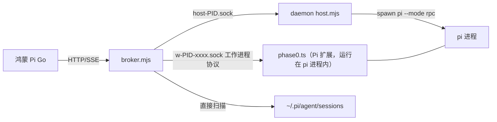
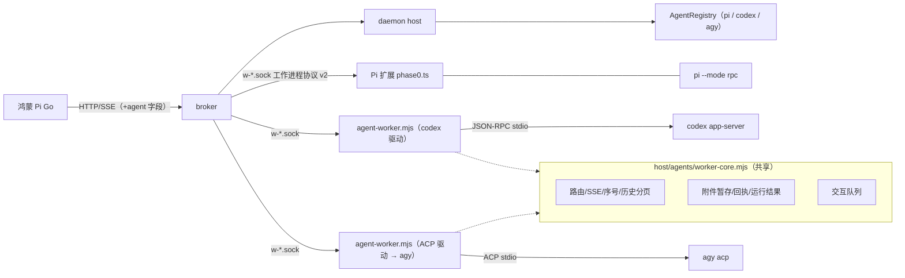
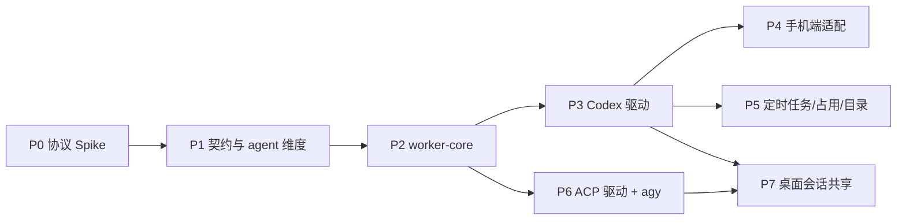

# 多 Agent 接入：架构设计与实施计划（Pi → Codex CLI → agy CLI）

> 状态：设计稿，2026-11-24。基于仓库 `9908086`、Codex CLI 0.171.0（`codex app-server`）、agy CLI（`agy acp`）。

## 1. 现状与关键接缝

现有链路（只支持 Pi）：



梳理代码后，Pi 耦合点集中在以下 5 处：

| 耦合点 | 位置 | 说明 |
|---|---|---|
| **工作进程协议实现** | `host/bridge/phase0.ts`（约 1086 行） | `/session /chat /history /events /prompt /abort /model /models /commands /rename /fork /upload…`，直接依赖 Pi `ctx`/`SessionManager` |
| 进程托管 | `host/daemon/runtimes.mjs` | `pi --mode rpc` + `extension_ui_request` 交互队列，`/pi-go-share` 触发共享 |
| 历史目录 | `daemon/catalog.mjs`、`bridge/computer-sessions.mjs` | 只扫描 Pi JSONL；会话 ID 正则写死为 UUID |
| 交互应答 | broker → host `/pending` `/answer`（按 pid 找 `RpcRuntime`） | 交互状态保存在 daemon 中，不在工作进程里 |
| 定时任务 / 进程占用 | `schedules.mjs`、`host.mjs#externalPiRunning` | 写死调用 `runtimes.start` / 用 ps 匹配 pi 进程 |

**核心判断**：broker 和手机只认 **工作进程 socket 协议**（`w-<pid>-<hex>.sock` + `GET /session` 注册）。所以接入新 Agent 的成本最低、风险也最低的做法是：**为每个 Agent 实现一个 “工作进程垫片”（worker shim），让它对 broker 提供与 Pi 扩展相同的协议，对下用该 Agent 的原生协议驱动。** broker 和手机基本不用改，只需补一个 `agent` 维度。

## 2. 目标架构



### 2.1 分层

| 层 | 职责 | 新增/改动 |
|---|---|---|
| **手机** | 展示 Agent 标识、新建会话时选择 Agent、按能力位显示或隐藏按钮、审批卡片 | 小改 |
| **broker** | 鉴权、路由、目录聚合；按 `agent` 做 open/new | 小改：目录来源改走 daemon，行数据增加 `agent` 字段，交互改为问工作进程 |
| **daemon host** | 工作区、会话交接、目录、定时任务 | 中改：`handoff` 通过 `AgentRegistry` 派发 |
| **AgentProvider**（每个 Agent 一个） | 探测安装/版本/登录、历史目录、启动工作进程、外部占用检测 | 新增 |
| **worker-core**（共享） | 实现工作进程 HTTP 协议的全部通用逻辑 | 新增，逻辑从 phase0.ts 中提炼 |
| **AgentDriver**（每个协议一个） | 把原生协议翻译成统一的会话接口和事件 | 新增：`codex-app-server`、`acp` |

### 2.2 目录结构

```
host/agents/
  contract.md              # 工作进程协议 v2 + 统一事件模型（手机/broker 依赖的唯一契约）
  registry.mjs             # AgentRegistry：providers 列表、按 id 查找、/health 能力汇总
  worker-core.mjs          # 通用 HTTP/SSE 服务，依赖 AgentSession 接口
  agent-worker.mjs         # 工作进程入口：node agent-worker.mjs --agent codex --cwd X [--session ID]
  jsonrpc.mjs              # 共享的 stdio JSON-RPC 2.0 客户端（codex 和 ACP 都用）
  pi/      provider.mjs    # 封装现有 runtimes.mjs + catalog.mjs（Pi 仍走扩展，不经 worker-core）
  codex/   provider.mjs  driver.mjs  catalog.mjs  map.mjs
  acp/     driver.mjs  map.mjs        # 通用 ACP 驱动
  agy/     provider.mjs               # 薄层：命令行参数、目录、探测；驱动复用 acp/
```

### 2.3 核心接口

```ts
interface AgentProvider {
  id: 'pi' | 'codex' | 'agy';
  label: string;
  detect(): Promise<{ installed: boolean; version?: string; authed?: boolean; reason?: string }>;
  validSessionId(id: string): boolean;          // 取代写死的 UUID 正则
  listSessions(): Promise<CatalogRow[]>;         // { agent, id, cwd, name, modified, messageCount }
  findSession(cwd: string, id: string): Promise<CatalogRow | undefined>;
  deleteSession?(row: CatalogRow): Promise<void>;
  externalRunning(knownPids: Set<number>): Promise<boolean>; // 删除/占用保护
  spawnWorker(opts: { cwd: string; sessionId?: string; scheduled?: boolean }): ManagedWorker;
}

interface ManagedWorker {               // daemon 侧句柄，替代 RpcRuntime 在 host.mjs 中的角色
  pid: number; cwd: string; sessionId?: string;
  awaitReady(expectedId?: string): Promise<{ sessionId: string }>;
  runScheduledPrompt(prompt: string, timeoutMs: number): Promise<ScheduledOutcome>;
  stop(): Promise<void>;
}

interface AgentSession {                // 驱动实现，worker-core 消费
  readonly capabilities: Capabilities;
  state(): SessionState;                // id/cwd/name/idle/runId/queued/model/thinkingLevel/agent
  history(before?: string, limit?: number): Promise<NormalizedMessage[]>;
  prompt(input: { text: string; images: Buffer[]; files: string[]; deliverAs: 'send' | 'steer' | 'followUp' }): Promise<void>;
  abort(): Promise<void>;
  listModels?(): Promise<ModelOption[]>;  setModel?(id: string, level?: string): Promise<void>;
  listCommands?(): Promise<CommandRow[]>;
  rename?(name: string): Promise<void>;   fork?(atMessageId: string): Promise<string>;
  answer(pendingId: string, answer: unknown): boolean;
  on(event: 'event', fn: (e: AgentEvent) => void): void;
}

type Capabilities = { steer: boolean; followUp: boolean; images: boolean; models: boolean;
  thinking: boolean; commands: boolean; rename: boolean; fork: boolean; regenerate: boolean; approvals: boolean };
```

`AgentEvent` 直接复用现有 SSE 帧：`session/status`、`message/delta`、`message/thinking`、`tool/start`、`tool/end`、`message/final`、`session/changed`、`queue/status`，再新增 `interaction/requested`。手机端的 `StreamFrame` 无需改动。

## 3. 关键设计决策

### D1：每个会话一个垫片进程（与 Pi 同构）
- `agent-worker.mjs` 自己创建 `w-<自身pid>-<hex>.sock` 并完成注册，broker 的发现逻辑、`workerIdentity(pid)` 都不用改。
- 崩溃隔离：codex/agy 子进程挂掉只影响一个会话，与 Pi 现有的 `RpcRuntime` 模型一致。
- 代价：每个会话多一个 node 进程。后续可以优化为多个 codex 线程共享一个 app-server（app-server 本身支持多线程）。

### D2：Codex 走原生 `codex app-server`，agy 走通用 ACP
- Codex app-server 提供的能力最完整：`thread/start|resume|fork|name/set|delete`、`turn/start|steer|interrupt`、`model/list`、`skills/list`，以及审批类服务端请求，远强于 ACP 适配层。
- agy 原生提供 `agy acp`。按 ACP 实现**通用驱动**，以后接 Gemini CLI、Claude Code（ACP 适配）等几乎零成本。
- 两种协议都是 stdio JSON-RPC 2.0，共用 `jsonrpc.mjs`。

### D3：交互状态下沉到工作进程
- Pi 目前是 daemon 中的 `RpcRuntime.uiQueue` 管交互，broker 去问 host `/pending`。新 Agent 的审批请求直接到达垫片进程，因此工作进程协议新增 `GET /pending`、`POST /answer`。
- broker 依据 `GET /session` 返回的 `interactions: 'worker' | 'host'` 决定问谁。Pi 保持 `host`，兼容已安装的扩展。

### D4：审批映射到现有交互类型（手机先不改）

| 原生请求 | 映射 | 选项 / 回写 |
|---|---|---|
| codex `item/commandExecution/requestApproval` | `select`，标题为命令和 cwd | 允许一次 / 本会话允许 / 拒绝 → `accept / acceptForSession / decline` |
| codex `item/fileChange/requestApproval` | `select`，消息体为改动摘要 | 同上 |
| codex `item/permissions/requestApproval` | `select` | 同上 |
| codex `item/tool/requestUserInput` | `input` 或 `select` | 回写文本 |
| codex `mcpServer/elicitation/request` | 首期直接拒绝并记录 | — |
| ACP `session/request_permission` | `select`，选项取自 `options[].name` | 回写 `optionId` |

`PendingInteraction` 增加可选字段 `kind: 'approval'`、`detail`（命令、diff 片段）。旧手机会忽略这两个字段，仍按 select 渲染；新手机渲染成审批卡片。

### D5：目录统一由 daemon 聚合
- 新增 host 路由 `/catalog-all`，汇总所有 provider 的 `listSessions()`，每行带 `agent`。broker 的 `computerSessions()` 改为调用该路由；daemon 不在时退回只扫描 Pi。
- Codex 目录：首选 app-server `thread/list`（稳定 API，含 cwd 和名称，由 daemon 内一个懒启动、空闲退出的 app-server 提供）；兜底扫描 `~/.codex/sessions/**/rollout-*.jsonl` 的 `session_meta`。
- agy 目录：ACP `session/list`（若 agy 未实现，则读 `--app-data-dir` 下的会话记录，需在 Spike 中确认）。
- 会话的唯一键从 `id` 变为 `(agent, id)`。session-metadata（置顶/归档）的键加上 agent 前缀，老数据默认归为 `pi`。

### D6：向后兼容策略
- 所有请求和返回中，缺省的 `agent` 视为 `pi`。`/open`、`/new` 增加可选 `agent` 参数。
- host `/health` 协议号保持 `pi-go-desktop-host/1`，新增字段 `agents: [{ id, label, installed, version, authed }]`。旧手机看不到新 Agent，但功能不受影响。
- 工作进程 `/session` 新增 `agent`、`capabilities`、`interactions` 字段，属于纯增量。

### D7：权限默认值（已确认：跳过审批和沙箱）
- 手机拉起的会话**默认跳过审批和沙箱**：
  - Codex：`thread/start|resume` 带 `approvalPolicy: "never"`、`sandbox: "danger-full-access"`（等同于 `--dangerously-bypass-approvals-and-sandbox`）。
  - agy：`agy acp --dangerously-skip-permissions`。
  - 定时任务使用同样的设置。
- 策略集中在 provider 的 `permissionProfile` 配置中（默认 `bypass`，保留 `ask` 选项）。可通过 `PIGO_CODEX_ARGS` / `PIGO_AGY_ARGS` 或设置项改回需要审批，D4 的审批映射代码仍保留，供 `ask` 模式和 `requestUserInput` 这类问答使用。
- 会话头和 `/session` 返回 `permission: 'bypass'`，手机上显示“完全访问”标识，用户能清楚知道当前权限状态。
- 共享桌面上已运行的会话（P7）时**不改动**它原有的权限，桌面上是什么就保持什么。

> [!WARNING]
> 采用 bypass 后，已配对手机等同于拥有该 Mac 用户的完整 shell 权限。配对凭证的保管、设备撤销和公网入口的安全性因此更加关键（参见 PLAN.md §8）。

## 4. 协议映射

### 4.1 Codex app-server → 工作进程协议

| 工作进程 | Codex |
|---|---|
| 启动 | `initialize` → `thread/start {cwd, approvalPolicy, sandbox}` 或 `thread/resume {threadId}` |
| `POST /prompt` send | `turn/start {threadId, input:[text, localImage…]}`（图片先落盘到 `.pi-go/attachments`） |
| `POST /prompt` steer | `turn/steer`；followUp 由 worker-core 本地排队，`turn/completed` 后发出 |
| `POST /abort` | `turn/interrupt` |
| `GET /models` / `POST /model` | `model/list` / 下一次 `turn/start` 带 `model`、`effort` |
| `GET /commands` | `skills/list` → `/skill:名字` |
| `POST /rename` / `POST /fork` | `thread/name/set` / `thread/fork` |
| `GET /chat` `/history` | `thread/turns/list` + `thread/items/list` → `NormalizedMessage` |
| 事件 `session/status` | `turn/started`（runId = turnId）、`turn/completed` |
| `message/delta` / `message/thinking` | `item/agentMessage/delta` / `item/reasoning/summaryTextDelta` |
| `tool/start` / `tool/end` | `item/started` / `item/completed`（commandExecution、fileChange、mcpToolCall、webSearch） |
| `session/changed` | `thread/name/updated`、`thread/settings/updated` |
| 运行结果 diff | `turn/diff/updated`（优先使用），否则用 `run-results.captureWorkspace` |

### 4.2 ACP（agy）→ 工作进程协议

| 工作进程 | ACP |
|---|---|
| 启动 | `initialize` → `session/new {cwd, mcpServers:[]}` 或 `session/load {sessionId}`（历史以 `session/update` 回放） |
| `POST /prompt` | `session/prompt {prompt:[text, image…]}`；不支持 steer（`capabilities.steer=false`），followUp 本地排队 |
| `POST /abort` | `session/cancel` 通知 |
| 模型 / 模式 | `session/set_model`、`session/set_mode`（unstable 能力，按 `initialize` 返回值开关） |
| `GET /commands` | `available_commands_update` |
| 事件 | `agent_message_chunk` → delta；`agent_thought_chunk` → thinking；`tool_call`/`tool_call_update` → tool start/end；`session/prompt` 返回的 `stopReason` → final |
| 历史 | 驱动在内存中保存 `session/load` 回放和实时事件的规范化副本（ACP 没有分页读取接口） |

## 5. 分阶段实施计划



| 阶段 | 内容 | 交付门槛 | 估算 |
|---|---|---|---|
| **P0 Spike** | 写 `host/scripts/probe-codex.mjs` 和 `probe-agy.mjs`：握手、新建/恢复、一轮对话、中断、bypass 模式、历史读取；**同时调研 P7 的附着能力**（Codex app-server daemon/proxy、agy `--remote-control`）。录制 JSON 夹具放到 `test/fixtures/{codex,agy}/`。确认 agy 会话 ID 格式、`session/list` 和 `session/load` 是否可用、Codex 线程 ID（UUIDv7）是否能通过现有正则 | 两份协议笔记 + 夹具；明确 agy 历史来源 | 2–3 天 |
| **P1 契约与 agent 维度** | 编写 `host/agents/contract.md`（工作进程协议 v2）；新增 `registry.mjs` 和 `pi/provider.mjs`（封装现有代码，**行为不变**）；host/broker/目录/元数据统一加 `agent` 字段（缺省为 pi）；`/health.agents`；**基于现有 Pi 写工作进程协议一致性测试** `test/worker-contract.test.mjs` | 全量 `npm test` 通过；一致性测试覆盖 Pi | 3–4 天 |
| **P2 worker-core** | 参照 phase0.ts 提炼通用路由、SSE（`liveSeq`/`sync=2` 游标）、历史分页、附件暂存、回执、运行结果、交互队列、followUp 本地队列；`agent-worker.mjs` 入口；用 **FakeDriver** 跑一致性测试。phase0.ts 暂不改动 | FakeDriver 通过同一套一致性测试；broker 能发现 fake 工作进程并聊天 | 4–5 天 |
| **P3 Codex** | `jsonrpc.mjs`、`codex/driver.mjs`（4.1 映射）、`codex/catalog.mjs`、`codex/provider.mjs`（探测 `codex --version` 和登录态、`externalRunning` 识别 codex 进程）；审批映射；daemon `handoff` 按 provider 派发。测试：codex 配置成**本地假 Responses API**（`-c model_providers.fake.base_url=http://127.0.0.1:PORT/v1`），离线跑完整链路 | 手机经 broker 打开 Codex 历史、新建、流式聊天、steer、中断、审批、改名、fork；离线集成测试通过 | 5–7 天 |
| **P4 手机端** | `SessionRow`/`SessionState` 增加 `agent` 和 `capabilities`；侧边栏和会话头显示 Agent 徽标；“新建会话”选择 Agent（只列出 `installed` 的）；按能力位隐藏 steer、思考档位、fork、regenerate、`/` 命令；审批卡片（`kind: 'approval'`，展示命令和 diff） | HAP 构建通过；源码测试（`harmony-source`）更新；真机验收清单 | 4–5 天 |
| **P5 横向能力** | `schedules.mjs` 的 job 增加 `agent`，经 `ManagedWorker.runScheduledPrompt` 执行；删除会话、关闭工作区、占用检测走 provider；run-push 和运行结果收件箱带上 agent | 定时任务可选择 Codex；删除被占用的 Codex 会话会被拒绝 | 2–3 天 |
| **P6 ACP + agy** | `acp/driver.mjs`（4.2 映射）、`agy/provider.mjs`；用**假 ACP Agent 脚本**做离线测试，用真实 agy 做 live smoke | agy 会话可新建、恢复、聊天、中断、审批；一致性测试通过 | 4–5 天 |
| **P7 桌面会话共享** | 让手机接入电脑上**正在运行**的 Codex/agy 会话（与 Pi 现有的“活跃会话自动发现”对等）。① P0 阶段同步调研：Codex `app-server daemon` + `proxy` 控制 socket 能否被 Codex TUI/Desktop 共用，以及 `thread/loaded/list` 和订阅已加载线程的事件；agy `--remote-control` 的协议和接入方式。② 实现 `LiveAttachProvider`：发现活跃会话后，以“附着”模式启动垫片（不新建 Agent 进程，不能杀掉 Agent，只订阅、发消息、中断），在目录中标记 `active: true`。③ 并发规则：桌面端和手机同时发送消息时，以 Agent 自身的队列为准；没有提供附着能力的 Agent 显示“仅电脑端可操作” | 电脑上开着 Codex TUI（或 Desktop）/ agy 时，手机能看到并接续该会话，实时看到电脑端的输出 | 5–8 天（取决于 P0 结论） |

合计约 **5–6 周**（单人，含 P7）。**P3 完成即可交付 Codex 的最小可用版本**（手机上看到的会话没有 Agent 徽标，但功能可用）。

### 5.0 已确认的决策（2026-11-24）
1. 手机拉起的会话**跳过审批和沙箱**（D7）。
2. 显示 Codex Desktop/VS Code 等**所有来源**的 Codex 线程，按 cwd 归入工作区。
3. 手机列表**混排 + Agent 徽标**，“新建会话”时选择 Agent。
4. **P7 纳入近期范围**：协议调研并入 P0，实现排在 P3 之后（先做 Codex 附着，再做 agy）。

### 5.1 首周执行顺序
1. P0 两个 probe 脚本 + 夹具（先 Codex）。
2. P1 一致性测试先行：把 phase0.ts 的现有行为固化成测试，作为 worker-core 和各驱动的验收标准。
3. P1 增加 `agent` 维度并引入 Pi provider 封装，确保零回归后合入。

## 6. 风险

| 风险 | 缓解 |
|---|---|
| Codex app-server 标注 `[experimental]`，协议可能变化 | 只依赖必要的方法；`initialize` 时记录版本；P0 夹具接入 CI；provider 设定最低版本，低于该版本时 `detect()` 报告不兼容 |
| ACP 的 `session/list`、`set_model` 属于 unstable | 按 `initialize` 返回的能力开关；agy 历史来源在 P0 确认 |
| 同一会话在桌面 TUI 和手机同时打开导致并发写入 | `externalRunning` + 打开前检测；占用时返回 `session_occupied`（沿用现有错误码） |
| phase0.ts 与 worker-core 两份实现逐渐分叉 | 一致性测试同时覆盖两者；稳定后（P6 之后）可考虑让 Pi 也改走 worker-core + RPC，扩展只保留终端共享 |
| 每会话一个进程的资源开销 | 首期接受；必要时让多个 codex 会话共享一个 app-server |

## 7. 待确认问题

已全部确认，见 §5.0。P0 结束后若发现 Codex/agy 不支持附着到运行中的会话，再回到这里讨论 P7 的降级方案（例如改为通过 Pi Go 启动桌面会话，由 Pi Go 托管，手机和桌面共同接入）。
